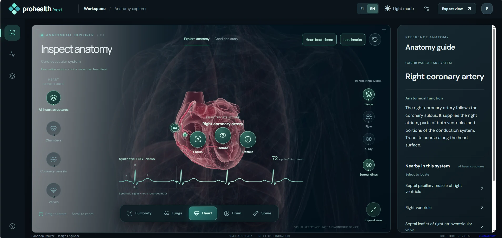
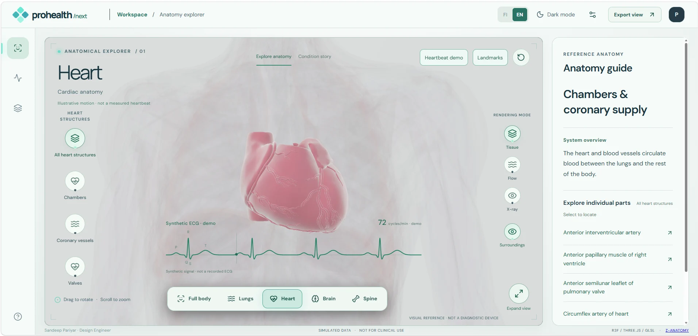

<div align="center">

# ProHealth
### Interactive 3D Human Anatomy & Healthcare Learning Platform

**A high-fidelity, tablet-first anatomy visualization experience — React · TypeScript · Three.js · WebGL / GLSL**

**Designed & Developed by Sandeep Pariyar**

[](https://sandeepariyar.github.io/ProHealth-Interactive-3D-Human-Anatomy-Healthcare-Learning-Platform/)

[](https://react.dev/) [](https://www.typescriptlang.org/) [](https://threejs.org/) [](https://vite.dev/)

</div>

**[▶ Open ProHealth in your browser](https://sandeepariyar.github.io/ProHealth-Interactive-3D-Human-Anatomy-Healthcare-Learning-Platform/)** — interactive 3D anatomy explorer; no installation required.

## Design exploration in Figma

**[Open the ProHealth design boards](https://www.figma.com/design/3rwlPVPyHmA87BmxGuIZQx)** — view-only access for anyone with the link.

The boards reverse-engineer the working application and explore its visual foundations, interface states, and design decisions.

- [Inspiration & research](https://www.figma.com/design/3rwlPVPyHmA87BmxGuIZQx?node-id=22-2)
- [Colors & themes](https://www.figma.com/design/3rwlPVPyHmA87BmxGuIZQx?node-id=21-2)
- [Buttons & states](https://www.figma.com/design/3rwlPVPyHmA87BmxGuIZQx?node-id=23-2)
- [Component patterns](https://www.figma.com/design/3rwlPVPyHmA87BmxGuIZQx?node-id=24-2)
- [Anatomy navigation](https://www.figma.com/design/3rwlPVPyHmA87BmxGuIZQx?node-id=27-2)
- [Logo & identity](https://www.figma.com/design/3rwlPVPyHmA87BmxGuIZQx?node-id=28-2)
- [Typography & text styles](https://www.figma.com/design/3rwlPVPyHmA87BmxGuIZQx?node-id=29-2)

These are editable visual specifications and design proposals, not a published component library or a fully wired Figma prototype. The live application remains the interactive demonstration.

### Design-to-development process

I started with an earlier design in Figma, then developed ProHealth into an interactive anatomy-learning prototype using React, TypeScript, Three.js and WebGL. The interface brings together anatomical exploration, structure selection, camera focus, isolation and session history.

I later revisited the working application to reconstruct and expand its Figma documentation: visual directions, color themes, button states, component patterns, anatomy navigation, logo treatments and typography. The linked boards document this later design exploration rather than the original Figma file.

This process connects interface design with implementation decisions and complex system behavior, including selection resets, restoration of previous views, rendering preferences and recovery states.

## Interface previews

**Dark mode — interactive 3D anatomy inspection**



**Light mode — cardiac anatomy explorer**



> These are actual application screenshots. The heart animation and ECG are illustrative; ProHealth is an educational visualization prototype, not a clinical tool.


## Overview

ProHealth is an interactive **3D human anatomy explorer** designed for educational demonstration and visual engineering research. It combines a cinematic, motion-led interface with navigable 3D anatomical systems and an inspection workflow inspired by clinical imaging workstations. The prototype is **not a medical device** and does not diagnose, treat, or analyze patient data.

## What it does

- **Explore seven registered anatomical systems**: skeletal, muscular, visceral, cardiovascular, nervous, joints and lymphatic anatomy.
- **Inspect and isolate structures**, pick landmarks, navigate regions, focus the camera and revisit session history.
- **Switch visual modes**: tissue, illustrative flow and X-ray-inspired shading; adjust render quality and layer visibility.
- **Explore focused systems**: heart, lungs, brain and spine, with illustrative cardiac-cycle and synthetic ECG demonstrations.
- **Use Finnish or English** with light/dark themes, responsive desktop/tablet UI and motion preferences.
- **Export viewport images** and navigate a reference-based educational condition guide.

## Engineering highlights

| Area | Implementation |
| --- | --- |
| Interface | React 19, TypeScript, Framer Motion-style `motion` animations, accessible controls |
| Real-time graphics | Three.js, React Three Fiber, React Three Drei, custom GLSL materials |
| Anatomy | Seven aligned, compressed GLB systems loaded from a pinned atlas manifest |
| Performance | Structure-aware mesh batching, spatial-index workers, lazy render effects, configurable quality |
| UX | Figma-led visual design, spatial inspection, immersive focus mode, bilingual content |
| Delivery | Vite, CMake-free web build, automated GitHub Pages workflow |

## Run locally

**Requirements:** Node.js 22+ and npm. An internet connection is required on first installation to fetch the licensed anatomy atlases.

```bash
npm ci
npm run assets:verify
npm run dev
```

Then open the local URL printed by Vite. To build the static site:

```bash
npm run build
npm run preview
```

> The anatomical GLB files are **not tracked in Git**. The installer downloads pinned files, checks their expected Git blob hashes, and prepares local Draco decoders. The GitHub Pages workflow downloads and verifies these assets during its build. To enable publishing for a new repository, select **Settings → Pages → Build and deployment → Source: GitHub Actions**.

## Suggested GitHub Topics

`react` · `typescript` · `threejs` · `anatomy` · `medical-visualization` · `webgl`

## Asset attribution and licensing

**Original ProHealth application code:** © 2026 Sandeep Pariyar, distributed under the MIT license in [LICENSE](LICENSE).

**Third-party anatomy:** The application uses geometry from [Z-Anatomy and BodyParts3D](https://github.com/nqwrc/3d-anatomy). These anatomical models are **not MIT licensed**; upstream model distribution specifies Creative Commons licenses, including **CC BY-NC-SA 4.0**, with source-specific attribution and share-alike/noncommercial restrictions. Read [public/models/NOTICE.md](public/models/NOTICE.md) before copying or distributing any model or model-derived work.

Clinical educational information is informed by [OpenStax Anatomy & Physiology](https://openstax.org/details/books/anatomy-and-physiology-2e) and [NIH/NHLBI](https://www.nhlbi.nih.gov/health/coronary-heart-disease). The 3D overlays, simulated ECG and pulse effects are illustrative and not measured physiological data.

## Design attribution

**Designed & Developed by Sandeep Pariyar**  
Visual interface, motion design, 3D rendering integration, application development and prototyping.

---

*ProHealth is an educational visualization and software portfolio prototype. It contains no patient records and is not intended for clinical decision-making.*
